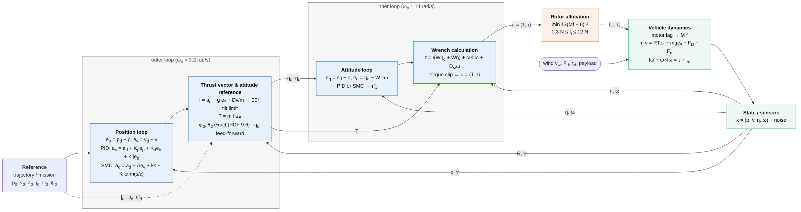
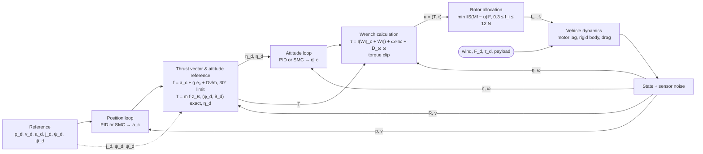

# Feedback Control of the 6-DOF Quadcopter — Design, Derivations and Viva Guide

**Project part 3 — Feedback Control · Maanya Sri · Group 1**
Code: `src/controllers.py`, `src/allocation.py` (plus `missions.py`, `references.py`, `disturbances.py`, `metrics.py`, `tuning.py`).
Every equation below is tied to the code that implements it. "(PDF x.y)" refers to the group's `quadcopter_model.pdf`. All numbers come from the custom NumPy simulator (`dynamics.py`, RK4, Δt = 0.01 s) and are reproduced by `python run_all_experiments.py`; full tables are in `results/metrics/`.

**Contents**
0 Conventions · 1 Feedback control · 2 Why not open loop · 3 Architecture (block diagram) · 4 Outer loop · 5 Desired-attitude-rate feed-forward (none / reference / full) · 6 Inner loop · 7 Sliding mode control and its disturbance bounds · 8 Stability arguments and their assumptions · 9 Rotor allocation and saturation · 10 Anti-windup · 11 Reset & numerical safety · 12 Why these controllers · 13 Tuning · 14 Metrics · 15 Experiments 1–8 · 16 PID vs SMC — where each wins and why · 17 MuJoCo · 18 Limitations · 19 Viva summary

---

## 0. Conventions (identical to the PDF)

| Item | Convention | Where in code |
|---|---|---|
| World frame {W} | x, y horizontal, **z up**, gravity −g e₃ | `dynamics.py` |
| Body frame {B} | x forward, **y left**, z up (rotor axis) | `kinematics.get_rotor_positions_body` (rotor 1 at (+, −) = front-right) |
| Rotation | R = R_z(ψ) R_y(θ) R_x(φ) (PDF 4.1–4.2) | `kinematics.euler_to_rot_matrix` |
| Angular velocity | ω_B = W(η) η̇, η̇ = W⁻¹ ω_B (PDF 4.7–4.8) | `attitude_jacobian_w`, `attitude_jacobian_w_inv` |
| State | x = (p, v, η, ω_B): `x[0:3]`, `x[3:6]`, `x[6:9]`, `x[9:12]` | everywhere |
| Inputs | f = (f₁…f₄), u = (T, τ_x, τ_y, τ_z) = M f (PDF 5.6) | `allocation.RotorAllocator.M` |
| Spin directions | σ = (+1, −1, +1, −1): rotors 1, 3 CCW, 2, 4 CW | row 4 of M, `dynamics.spin_dirs`, MJCF gears |
| Errors | e = desired − actual | controllers |

## 1. What feedback control means for a quadcopter
The trajectory generator says where the vehicle *should* be: p_d(t), v_d(t), a_d(t), jerk j_d(t), yaw ψ_d(t), ψ̇_d(t). The controller measures where it *is* (state x) and, 100 times a second, computes four rotor thrusts that push the difference towards zero. Because the command depends on the measured error, anything that makes the vehicle deviate — wind, a wrong mass, a gust torque, a bad start — is seen and corrected.

## 2. Why open-loop control is not enough
Open loop would compute rotor thrusts from the reference alone (flatness, PDF 9.4) and never look at the state. It fails because (1) the attitude dynamics are a chain of four integrators τ → ω → θ → ẋ → x with no restoring term (PDF 9.4–9.5), so the smallest torque error grows without bound; (2) disturbances and model errors (PDF Sec. 8) are unknown in advance; (3) initial errors never decay.

---

## 3. Architecture



*(Source: `docs/figures/control_architecture.mmd`; the same diagram renders natively on GitHub:)*



The quadcopter is under-actuated (4 inputs, 6 DOF): it moves sideways only by tilting the thrust (PDF 6.2: ẍ ≈ gθ, ÿ ≈ −gφ). Hence the cascade: the **outer loop** (≈3.2 rad/s) decides *which thrust vector* is needed, the **inner loop** (≈14 rad/s, 4.4× faster) rotates the body to produce it, the **wrench calculation** turns the wanted angular acceleration into body moments by inverting the rotational dynamics, and the **allocator** turns (T, τ) into four feasible rotor thrusts. The plant receives u = M f, which is exactly achievable, so no hidden clipping happens downstream. Wrench chain logged in every run: `u_raw` (what the feedback law asked) → `u_req` (after the thrust-range and torque clips) → `u` = M f (what the rotors produce).

---

## 4. Outer loop — from position error to thrust and desired attitude

### 4.1 Errors and the PID law (`CascadedPIDController.compute_control`)
```
e_p = p_d − p,   e_v = v_d − v
a_c = a_d + K_p ẽ_p + K_d e_v + K_i ∫ e_p dt
```
| Term | Physical meaning |
|---|---|
| a_d | feed-forward: the acceleration the trajectory itself needs |
| K_p ẽ_p | "spring" towards the reference |
| K_d e_v | "damper", uses measured v (no numerical differentiation) |
| K_i ∫e_p | removes steady error from constant unknown forces |

**Position-error clamp (new).** ẽ_p is e_p with its horizontal norm limited to v_max,xy·K_d/K_p (v_max,xy = 5 m/s) and its vertical part to v_max,z·K_d/K_p (2.5 m/s) (`_clamp_position_error`). In saturated steady flight a_c = 0 ⇒ |e_v| = (K_p/K_d)|ẽ_p| ≤ v_max, so a far-away target is approached at a bounded speed the vehicle can still brake from. Experiment 6 found this was needed: with a 25 m reference step the saturated PD built ≈12 m/s and overshot the target by **8.3 m**; with the clamp the overshoot is **0.47 m**. The clamp is inactive for errors below ≈2.2 m (xy) / 0.9 m (z), so the nominal results and the tuning are unchanged. For SMC the same speed bound uses ratio 1/Λ + 1/(k + K/ε) (Sec. 7).

### 4.2 Gravity and drag compensation
From PDF 6.1 with F_D = −D(v − v_w), wanting v̇ = a_c needs the specific force
```
f = a_c + g e₃ + D v / m       (drag on the measured v cancelled; wind v_w unknown → disturbance)
```

### 4.3 Thrust-vector limits (`_limit_specific_force`)
0.4 g ≤ f_z ≤ g + 5 m/s² and ‖f_xy‖ ≤ min(6 m/s², f_z tan 30°) — exactly the 30° tilt limit of PDF Sec. 4.4. The horizontal part is scaled as a vector (direction preserved).

### 4.4 Thrust magnitude
T = m f·z_B with z_B = R e₃ (current body axis), clipped to [4 f_min, 4 f_max]. Equals ‖F_T‖ of PDF 9.6 once R = R_d; gives less thrust while the tilt is still wrong.

### 4.5 Desired roll and pitch — exact (PDF 9.6)
With f′ = R_z(ψ)ᵀ f = (f₁, f₂, f₃), since R_z(ψ)ᵀ z_B = (cosφ sinθ, −sinφ, cosφ cosθ):
```
θ_d = atan2(f₁, f₃),    φ_d = atan2(−f₂, √(f₁² + f₃²))
```
Small-angle limit = PDF 9.7. **Which ψ?** The tilt is resolved with the *measured* yaw (`tilt_from_measured_yaw=True`), so the thrust direction is what the outer loop asked for even while yaw is still turning. Experiment 7 (T7, 170° yaw step during a 2 m/s cruise) shows why: measured-yaw resolution keeps the cross-track error at **5 mm**; resolving with ψ_d (textbook R_d) rotates the thrust with the yaw error and gives **0.44 m (PID) / 1.88 m (SMC)**.

---

## 5. Desired-attitude-rate feed-forward: `none`, `reference`, `full`

### 5.1 What is computed
A moving trajectory needs a moving attitude. The inner loop tracks η_d *and* η̇_d. Differentiating Sec. 4.5 analytically (`_tilt_rates`):
```
ḟ′ = R_z(ψ)ᵀ ḟ + ψ̇ (f₂, −f₁, 0)
θ̇_d = (f₃ ḟ′₁ − f₁ ḟ′₃) / (f₁² + f₃²)
φ̇_d = (−ρ ḟ′₂ + f₂ ρ̇) / ‖f‖²,      ρ = √(f₁² + f₃²),  ρ̇ = (f₁ ḟ′₁ + f₃ ḟ′₃)/ρ
ψ̇_d  from the reference
```
The only unknown is ḟ = ȧ_c (+ the derivative of the drag term, neglected). The three modes differ in how ȧ_c is formed:

| Mode | ȧ_c used | ψ̇_d used | Derivatives needed | Approximations |
|---|---|---|---|---|
| `none` (original code) | — (η̇_d = 0) | no | none | assumes the attitude is constant along the path: the inner loop *damps* the rotation the trajectory requires |
| **`reference` (default)** | j_d | yes | reference jerk j_d (analytic, from the polynomial) and ψ̇_d | ignores the derivative of the feedback terms (K_p e_v + K_d ė_v + K_i e_p for PID; their SMC counterpart): exact only when tracking errors are constant |
| `full` | PID: j_d + K_p e_v + K_d(a_d − â) + K_i e_p · SMC: j_d + Λ(a_d − â) + (k + (K/ε)(1 − tanh²(s/ε)))ṡ_p, ṡ_p = (a_d − â) + Λe_v | yes | additionally the vehicle acceleration, *estimated* from the model: â = (T_prev/m) R e₃ − g e₃ − D v/m | â ignores the unknown disturbance and mass error, and uses noisy measured R and v; feedback-term derivatives amplify sensor noise |

Common to all three: components of f that are saturated (tilt or thrust limit) have derivative 0; the drag-term derivative D v̇/m is neglected; **η̈_d ≈ 0** (it would need the reference snap); η̇_d is bounded to ±3 rad/s (`max_euler_rate_ff`). The yaw channel uses ψ̇_d directly, so in `none` yaw also loses its rate feed-forward.

### 5.2 Experimental comparison (Experiment 4)
Same reference, same initial state, same Δt, same seed; only `rate_feedforward` changes. Nominal Exp-1 mission, the same mission 1.5× faster, a 5 m/s² circle with the camera kept on the centre (continuous 1.3 rad/s yaw), each with and without sensor noise, plus the nominal mission under a 5 m/s wind and a +35 % payload. `results/metrics/exp4_feedforward.md`, figures `exp4_feedforward_bars.png`, `exp4_feedforward_timeseries.png`.

Position RMSE (m) / attitude-error RMS (deg) / rotor-thrust variation (N/s), with sensor noise:

| Reference | Controller | `none` | `reference` | `full` |
|---|---|---|---|---|
| nominal mission | PID | 0.0166 / 4.88 / 53.7 | 0.0143 / 2.15 / 53.6 | 0.0143 / 2.05 / 58.6 |
| | SMC | 0.0213 / 9.13 / 53.7 | 0.0157 / 2.35 / 53.8 | 0.0156 / 2.27 / 59.7 |
| mission 1.5× faster | PID | 0.0978 / 7.74 / 55.5 | 0.0548 / 3.49 / 56.0 | **0.0497** / 3.24 / 61.7 |
| | SMC | 0.1614 / 14.49 / 54.2 | 0.0791 / 4.43 / 55.7 | **0.0569** / 3.32 / 62.4 |
| circle 5 m/s², yaw on centre | PID | 0.0070 / 13.71 / 53.0 | 0.0032 / 1.86 / 52.9 | 0.0031 / 1.75 / 58.8 |
| | SMC | 0.0144 / 47.79 / 70.8 | 0.0059 / 2.13 / 54.8 | 0.0055 / 2.03 / 61.6 |
| nominal + 5 m/s wind + 35 % payload | PID | 0.0382 / 4.75 / 48.3 | **0.0377 / 1.84 / 48.3** | 0.0382 / 1.86 / 55.8 |
| | SMC | 0.1390 / 9.12 / 45.9 | **0.1357 / 2.11 / 46.4** | 0.1455 / 3.00 / 56.6 |

Actuator saturation: rotors at a limit ≤ 0.6 % of the time in every case. Time at the tilt limit on the fast mission: `none` 6.2 % (PID) / 11.7 % (SMC), `reference` 4.4 / 4.9 %, `full` 4.1 / 4.6 %.

**Interpretation.**
* `none` is clearly worst: 1.2–1.4× the position error on nominal flight, 1.8–2× on the fast mission, and the attitude error is 2–22× larger. On the circle the yaw lags so far behind (no ψ̇_d) that SMC's attitude error reaches 48°. Lagging attitude also pushes the outer loop into saturation more often.
* `full` vs `reference`: on fast, feasible-model references `full` is better (fast mission: −9 % PID, −28 % SMC RMSE) because it anticipates how the *feedback* part of a_c will change. Its costs: 9–22 % more rotor-thrust variation — on the nominal mission the noise-free variation is identical (1.1 vs 1.1 N/s), so there the increase is pure noise amplification from the differentiated feedback terms; on the fast mission `full` also commands faster changes (6.8 vs 5.4 N/s noise-free) — and when the model is wrong (wind, payload) â is biased, so its feed-forward is wrong — with the disturbance it is worse than `reference` (SMC 0.146 vs 0.136 m, 3.0° vs 2.1°).
* Default **`reference`**: best on the tuning objective (Sec. 13), equal on nominal flight, most robust to model error and noise. `full` is the better choice only for aggressive flight with a well-identified model.

---

## 6. Inner loop — attitude errors and torque

### 6.1 Errors in Euler-angle coordinates
```
e_η = η_d − η (yaw wrapped),     ė_η = η̇_d − η̇,   η̇ = W(η)⁻¹ ω_B
```
All quantities are Euler-angle coordinates (ω_B ≠ η̇ unless φ = θ = 0, PDF 4.3). The yaw error in the P/sliding term is limited to ±30°, so a yaw step gives a bounded yaw manoeuvre.

### 6.2 Wrench calculation — computed torque (`_torque_from_euler_accel`)
From ω_B = W η̇: ω̇_B = W η̈ + Ẇ η̇. With PDF 7.2 and the model's angular drag,
```
τ = I ( W(η) η̈_c + Ẇ(η, η̇) η̇ ) + ω × (I ω) + D_ω ω
```
makes η̈ = η̈_c exactly for the nominal model: three decoupled double integrators. ω×Iω is the gyroscopic/Coriolis compensation (PDF 7.3–7.4); Ẇη̇ accounts for Euler rates not being body rates. The rotor-gyro moment (neglected in the PDF, A4) is left as a disturbance.

### 6.3 PID attitude law and torque saturation
η̈_c = K_p,att e_η + K_d,att ė_η + K_i,att ∫e_η (η̈_d ≈ 0). τ clipped per axis to (1.0, 1.0, 0.3) N m — the yaw limit reflects the small yaw lever k = 3.8 cm.

---

## 7. Sliding mode control and its disturbance bounds

### 7.1 Surfaces, control law, reaching law
```
s_p = e_v + Λ_p ẽ_p                       s_η = ė_η + Λ_η e_η
a_c  = a_d + Λ_p e_v + k_p s_p + K_p tanh(s_p/ε_p)
η̈_c = Λ_η ė_η + k_η s_η + K_η tanh(s_η/ε_η)
```
On s = 0 the error obeys ė = −Λe, whatever the disturbance — the controller's only job is to keep s at 0. With the loop's plant written as v̇ = a_c + d_p (outer, after gravity/drag cancellation) or η̈ = η̈_c + d_η (inner, after computed torque), substitution gives the reaching law
```
ṡ = −k s − K tanh(s/ε) − d
```
−k s pulls hard far from the surface; −K tanh(s/ε) is a bounded switching term that dominates any disturbance smaller than K. tanh instead of sign(s) removes chattering: with sampling (10 ms), motor lag (20 ms) and noise, sign(s) would switch ±K every sample; inside |s| < ε the tanh law is linear with gain k + K/ε.

### 7.2 What the switching gains assume
The gains K are not free parameters: each one is a *claimed bound* on the disturbance its loop sees, expressed in that loop's units.

| Loop | Disturbance in sliding-variable units | Assumed bound (design) | Gain |
|---|---|---|---|
| outer x, y | d = (K_D v_w + F_d)/m (+ attitude lag, tilt saturation) | 10 m/s wind → 1.43 m/s²; 1.5 N → 1.43 m/s² | K_p,xy = 2.0 m/s² |
| outer z | mass error, steady equivalent Δm g / m (+ vertical F_d) | ≈ +25 % payload → 2.45 m/s² | K_p,z = 2.5 m/s² |
| inner roll/pitch | d_η = W⁻¹ I⁻¹ τ_d | 0.10 N m → 12.3 rad/s² | K_η = 15 rad/s² |
| inner yaw | I_zz⁻¹ τ_d,z | 0.03 N m → 2.1 rad/s² | K_η,z = 3 rad/s² |

Why Δm g/m for a mass error: with mass m + Δm, v̇ = (m/(m+Δm))(a_c + g e₃) − g e₃, so holding altitude needs a_c,z = Δm g/m — that is the equivalent constant disturbance the outer loop must reject.

### 7.3 Lyapunov argument — exactly what it guarantees
Per axis, V = ½s², V̇ = −k s² − K s tanh(s/ε) − s d. For |s| ≥ ε, tanh(|s|/ε) ≥ tanh 1 ≈ 0.76, so
```
V̇ ≤ −k s² − (0.76 K − D̄) |s| < 0      whenever  |d| ≤ D̄ < 0.76 K.
```
Then s enters the boundary layer and stays there. For a constant d, the steady state solves **k s + K tanh(s/ε) = |d|**, and since ė = −Λe + s, the residual error is **|e| = s/Λ** (not zero — no integrator). This prediction is verified in Experiment 8 to within 1–3 mm.

**It is *not* a guarantee of disturbance rejection when the disturbance exceeds the assumed bound.** If |d| > 0.76 K the derivative of V is no longer negative outside the layer: s can leave the layer (Exp 8: |s|/ε up to 1.4) and the error grows until the linear term k s balances it. Because of k s the error still stays bounded in our tests (it settles where k s + K tanh(s/ε) = |d|) — but that is an observed property of this particular reaching law, not robustness in the SMC sense, and with a larger disturbance or saturation it can fail.

### 7.4 Bound check against the experiments (Experiment 8)
Disturbance computed from the injected inputs (wind, F_d, τ_d, payload) in sliding-variable units; `results/metrics/exp8_pid_vs_smc.md`.

| Scenario | peak per-axis d_p (m/s²) vs K_p = (2, 2, 2.5) | peak d_η (rad/s²) vs K_η = (15, 15, 3) | bound | max abs(s_p)/ε_p | SMC residual predicted / measured (m) |
|---|---|---|---|---|---|
| S1 step wind 10 m/s | (1.14, 0.86, 0) | 0 | holds | 0.46 | 0.090 / 0.091 |
| S2 varying wind | (0.57, 0.57, 0) | 0 | holds | 0.29 | 0.040 / 0.044 |
| S3 constant force 1.5 N | (0, 1.43, 0) | 0 | holds | 0.56 | 0.091 / 0.091 |
| S4 constant force 3.5 N | (0, 3.33, 0) | 0 | **exceeded** | 1.24 | 0.234 / 0.234 |
| T1 gust 12 m/s | (0, 1.71, 0) | 0 | holds | 0.51 | — (transient) |
| T3 force pulse 5.7 N | (3.81, 0, 3.81) | 0 | **exceeded** | 1.39 | — |
| T4 torque pulse | 0 | (12.3, 9.9, 2.1) | holds | 0.30 | — |
| P1 +35 % payload | (0, 0, 3.43) | 0 | **exceeded** | 0.92 | 0.159 / 0.159 |
| P2 +35 % payload 6 cm off-centre | (0, 0, 3.43) | (0, 26.7, 0) | **exceeded** (both loops) | 1.03 | 0.159 / 0.213 |

Reading the table: even *inside* the bound the SMC leaves a residual (9 cm for a 10 m/s wind) — the guarantee is convergence to the boundary layer, not to zero error. Outside the bound the residual is still predicted exactly by the steady reaching-law balance for the translational loop; in P2 the extra 5 cm comes from the attitude loop, whose bound is also exceeded (27 vs 15 rad/s²) and which therefore holds a steady tilt error.

---

## 8. Stability arguments — and every assumption behind them

Neither controller comes with a proof of stability for the complete nonlinear, saturated, cascaded system. What can be stated, and under which assumptions:

**Common modelling assumptions (both controllers)**
* **M1 Model match.** Mass, inertia, drag coefficients and allocation matrix used by the controller equal the plant's; any mismatch (payload, wind, unmodelled ground effect, rotor gyro, motor lag) enters as a disturbance.
* **M2 Exact inversion.** Gravity, drag and the rotational dynamics are cancelled exactly (Sec. 4.2, 6.2), so each axis is a double integrator.
* **M3 No saturation.** Tilt, thrust, torque and rotor limits are inactive. When they are active the closed loop is not the linear/sliding system analysed below; behaviour under saturation is shown experimentally (Sec. 9, 10, 15).
* **M4 Time-scale separation.** The outer loop assumes the commanded thrust vector is realised instantly. The inner loop is 4.4× faster (14 vs 3.2 rad/s), which makes this plausible, but the interconnection is *not* proven stable (that would need a singular-perturbation or input-to-state-stability argument); it is checked only in simulation.
* **M5 Euler validity.** |θ| < 90° (det W = cos θ ≠ 0); the 30° tilt *command* limit keeps the vehicle far from it (actual tilt peaked at 36° in the most violent infeasible steps, Exp 7).
* **M6 Actuators.** Motor lag (τ_m = 20 ms ↔ 50 rad/s) is fast compared with the inner loop and is treated as negligible; the sample time (10 ms) likewise.
* **M7 Measurement.** The controller sees the state with small white noise, no delay and no estimator dynamics.
* **M8 Reference.** The reference is smooth (bounded a_d, j_d) and feasible; infeasible references are handled by the limits, outside the analysis.

**PID (under M1–M8):** each position axis obeys ë + K_d ė + K_p e + K_i ∫e = −d, characteristic polynomial s³ + K_d s² + K_p s + K_i. Routh–Hurwitz: stable iff K_d, K_p, K_i > 0 and K_d K_p > K_i — satisfied with margin (xy: 6.56·14.85 = 97 > 8.19; z: 168 > 14.2; roll/pitch: 21.35·230.3 = 4917 > 343; yaw: 315 > 22). Result: exponential convergence of the error, and zero steady error for constant d. It is a *local* statement for the decoupled linearised error dynamics.

**SMC (under M1–M8 plus):**
* **S1** each loop's equivalent disturbance is bounded by a known D̄ with D̄ < 0.76 K (Sec. 7.2 — the assumption behind each switching gain);
* **S2** the disturbance is allowed to be any bounded signal, but the residual bound of Sec. 7.3 is for a constant d.
Result: per-loop convergence of s to the boundary layer and a bounded tracking error |e| = s/Λ. Not zero error; not valid when S1 is violated (Exp 8: S4, T3, P1, P2).

---

## 9. Rotor allocation and actuator saturation

### 9.1 Method (`allocation.py`)
u = M f with M from `kinematics.control_allocation_matrix` / k_t (same rotor order, geometry, spins as the dynamics). If f = M⁻¹u is within [f_min, f_max] = [0.30, 12.0] N it is used; otherwise
```
min_f ‖S (M f − u)‖²   s.t.  f_min ≤ f_i ≤ f_max,     priorities roll/pitch (10) > thrust (1) > yaw (0.3)
```
solved exactly by enumerating the 3⁴ active sets. A naive alternative, f = clip(M⁻¹u), is kept (`RotorAllocator(method="clip")`) for comparison only.

### 9.2 Requested vs achieved wrench (Experiment 5)
Three saturating cases, both controllers, both allocators; `results/metrics/exp5_saturation.md`, figures `exp5_wrench_S1_pid.png`, `exp5_wrench_S1_smc.png`, `exp5_tracking_allocators.png`.

S1 — large initial error (2.1 m, 25°/−20° tilt, 60° yaw error, spinning):

| Metric | PID constrained | PID clip | SMC constrained | SMC clip |
|---|---|---|---|---|
| allocation saturated (time fraction) | 0.043 | 0.053 | 0.013 | 0.018 |
| a rotor at f_min / at f_max | 0.043 / 0 | 0.053 / 0 | 0.013 / 0 | 0.018 / 0 |
| torque clip active | 0.045 | 0.043 | 0.013 | 0.017 |
| tilt limit active | 0.161 | 0.211 | 0.183 | 0.201 |
| RMS(T − T_raw) (N) | **0.117** | 0.455 | **0.060** | 0.218 |
| RMS(τ_x − τ_x,raw) (N m) | **0.056** | 0.126 | **0.0001** | 0.035 |
| RMS(τ_y − τ_y,raw) (N m) | **0.0002** | 0.072 | **0.0001** | 0.035 |
| RMS(τ_z − τ_z,raw) (N m) | 0.124 | **0.100** | 0.062 | **0.047** |
| max abs(τ_x − τ_x,req) caused by allocation (N m) | **0.001** | 0.472 | **0.001** | 0.358 |
| position RMSE (m) | **0.694** | 0.751 | **0.797** | 0.860 |

S2 (4 m sideways + 2 m up position step) and S3 (3 m step with a simultaneous 170° yaw step) saturate less: rotors at f_min for 1.3–1.4 % of the time (PID), never for SMC; with clipping the allocation error in τ_x reaches 0.30 N m vs 0.006 N m with the constrained allocator, while the tracking difference is small (≤ 0.5 %).

**What this shows.**
* **Where saturation happens.** f_max = 12 N was never reached in any experiment: the outer loop caps the commanded specific force at g + 5 m/s² (T ≤ 15.6 N ≈ 1.3 f_max in total), so rotors saturate only at **f_min**, when large roll/pitch/yaw moments are demanded around hover thrust. The limit hierarchy — tilt limit, then torque clip, then allocation — means the allocator itself is active only 1–5 % of the time even in the most violent cases, and never in nominal or disturbance flight (Exp 1, 2, 8: 0 %).
* **Constrained vs clipping.** Clipping distorts every channel, including the roll/pitch moments that keep the thrust vector pointing correctly (τ_x error 0.47 N m peak) and the total thrust (4× larger thrust error). The constrained allocator preserves roll/pitch almost exactly and sacrifices yaw by design (yaw error slightly *larger* than with clipping, 0.12 vs 0.10 N m, and yaw RMS 19° vs 16°). Net effect on tracking: 7–8 % lower position RMSE in S1.
* **Effect on tracking.** In S1 the RMSE while any limit is active is 1.6–1.8 m vs 0.07–0.32 m otherwise — saturation coincides with the large-error transient (it is the *consequence* of the large error, and it slows the recovery because the vehicle can only tilt and turn so fast).

---

## 10. Anti-windup

### 10.1 Mechanisms (PID only — SMC has no integrator)
1. **Conditional integration:** an axis whose thrust-vector command is saturated in the direction its error pushes does not integrate; the z integral also freezes when the allocator could not deliver the requested thrust; an attitude axis freezes when its torque is clipped in the direction of its error.
2. **Integral separation:** a position axis integrates only while |e_p| < 0.3 m.
3. **Clamp:** |K_i ∫e_p| ≤ (2.5, 2.5, 3.0) m/s², |K_i,att ∫e_η| ≤ (4, 4, 1) rad/s².
`CascadedPIDGains(anti_windup=False)` disables all three (for the study only).

### 10.2 Prolonged saturation and recovery (Experiment 6)
`results/metrics/exp6_antiwindup.md`, figure `exp6_antiwindup.png` (response, error, and K_i∫e on a symlog scale).

| Case | Metric | PID, anti-windup ON | PID, anti-windup OFF | SMC |
|---|---|---|---|---|
| W1 25 m reference step (tilt limit) | max K_i∫e_x (m/s²) | **0.42** | 2951 | — |
| | overshoot past target (m) | **0.47** | 63.9 (diverges) | 0.003 |
| | settling to 5 cm (s) | **6.76** | never | 8.23 |
| W2 6.5 N downward for 3 s at 10 m (climb authority exceeded) | max K_i∫e_z (m/s²) | **0.73** | 843 | — |
| | min altitude (m) | 4.13 | **0.0 (hits the ground)** | 4.25 |
| | overshoot above 10 m after release (m) | **0.03** | 20.5 | 0.001 |
| | recovery to 5 cm after release (s) | **3.35** | never | 4.06 |
| W3 0.33 N m yaw torque for 1.5 s (yaw torque limit exceeded) | max K_i,ψ∫e_ψ (rad/s²) | **1.38** | 23.7 | — |
| | yaw swing past 0° on the way back (deg) | **3.8** | 44.7 | 0.02 |
| | recovery to 5° (s) | **1.31** | 3.86 | 2.59 |

The integral terms stay within their clamps (and far below them in position, thanks to integral separation), and recovery after saturation is fast and almost overshoot-free. Without anti-windup the integrators reach 10²–10³ m/s² and the vehicle overshoots by tens of metres or crashes. SMC, having no integrator, cannot wind up — its slower recoveries in W1/W2 come from the speed bound and its lower effective gain, not from windup.

---

## 11. Controller reset and numerical safety
`reset()` clears integrators and the last-thrust memory; `simulate_mission` calls it and resets the motor-lag state; two consecutive runs with the same controller object are bit-identical (test). Tilt-rate formulas divide by f₃ ≥ 0.4 g. η̇_d, yaw error, torques and thrusts are bounded; 500 random extreme states give finite outputs (test).

## 12. Why these two controllers
**Cascaded PID** is the industry baseline (PX4, ArduPilot); on top of exact inversion it is a nonlinear PID whose linear tuning rules are exact for the nominal model, and its integrator gives zero steady error. **SMC** is the classic robust alternative with an explicit, checkable robustness statement (Sec. 7.3) for disturbances below a known bound. Both share reference generation, inversion, limits and allocation, so comparisons isolate the feedback law: *integral action vs. bounded switching robustness*.

## 13. How the gains were tuned (`src/tuning.py`, `experiments/run_tuning.py`)
1. **Pole placement** start (PID: (s+α)(s² + 2ζω_n s + ω_n²), α = ω_n/4 (position), ω_n,att/8 (attitude); SMC: K from the disturbance bound).
2. **Dedicated tuning mission** never used for evaluation, nominal + a robustness condition (+10 % mass, 2 m/s wind, 2.2 N force pulse, 0.05 N m torque pulse), same seeded sensor noise.
3. **Objective** J = RMSE + 0.25 e_max + 0.5·attitude RMSE[rad] + 0.0005·thrust variation + 10·rotor-saturation fraction.
4. **Stage-wise sweeps** (outer → inner → outer): PID 66 designs, SMC 191 designs.
5. Iterations documented: noise-free sweeps pushed gains to the grid edge; noise-only made tracking negligible; disturbance pulses balanced both; the feed-forward mode was fixed to `reference` and the sweep re-run.

| | Final design | Final gains |
|---|---|---|
| PID | ω_n 3.2, ζ 0.9, ω_n,att 14, ζ_att 0.7 | K_p = (14.85, 14.85, 21.38), K_d = (6.56, 6.56, 7.87), K_i = (8.19, 8.19, 14.16); K_p,att = (230.3, 230.3, 36.8), K_d,att = (21.35, 21.35, 8.54), K_i,att = (343, 343, 22.0) |
| SMC | Λ_p 4, k_p 2, ε_p 1, Λ_η 12, k_η 8, ε_η 2 | Λ_p = (4, 4, 4.8), k_p = (2, 2, 2.4), K_p = (2, 2, 2.5), ε_p = 1; Λ_η = (12, 12, 4.8), k_η = (8, 8, 3.2), K_η = (15, 15, 3), ε_η = 2 |

The position-error clamp added later (Sec. 4.1) is inactive for all tuning-mission errors (< 0.2 m), so the tuning result is unaffected. A unit test checks the defaults against `results/tuning/final_gains.json`.

## 14. Metrics (`src/metrics.py`)
True state (not the noisy measurement), trapezoidal rule, identical for all runs. RMSE, e_max, IAE/ISE/ITAE; settling time (stays inside the band until the end); overshoot; recovery time (settling from the end of the disturbance) and total time outside the band; attitude error (wrapped yaw); effort ∫‖f‖²dt, ∫(T − mg)²dt, ∫‖τ‖²dt; rotor-thrust total variation (chattering indicator); **allocation metrics** (new): RMS and max of u − u_raw per channel (T, τ_x, τ_y, τ_z), the part caused by the allocator alone (u − u_req), fractions of time with the torque clip active, a rotor at f_min, a rotor at f_max, per-rotor limit fractions.

---

## 15. Experiments

| # | Script | Question |
|---|---|---|
| 1 | `run_experiment1_nominal.py` | nominal surveillance mission |
| 2 | `run_experiment2_disturbances.py` | step wind, gust, force pulse, torque pulse |
| 3 | `run_experiment3_challenging.py` | large initial error, off-centre payload, 1.5× faster mission |
| 4 | `run_experiment4_feedforward.py` | `none` / `reference` / `full` feed-forward (Sec. 5.2) |
| 5 | `run_experiment5_saturation.py` | requested vs achieved wrench, constrained vs clipping (Sec. 9.2) |
| 6 | `run_experiment6_antiwindup.py` | prolonged saturation and recovery (Sec. 10.2) |
| 7 | `run_experiment7_challenging_trajectories.py` | high-acceleration, infeasible and yaw-heavy references |
| 8 | `run_experiment8_pid_vs_smc.py` | PID vs SMC by disturbance class + SMC bound check (Sec. 7.4, 16) |

### Experiments 1–3 (summary)
| Case | Metric | PID | SMC |
|---|---|---|---|
| Exp 1 nominal mission | RMSE / max airborne (m) | **0.0143** / **0.0158** | 0.0157 / 0.0269 |
| Exp 2A step wind 10 m/s | error last 2 s (m) | **0.004** | 0.089 |
| Exp 2C force pulse 5.7 N | recovery to 5 cm (s) | 2.78 | **0.58** |
| Exp 3A large initial error | overshoot (%) / settling 10 cm (s) | 2.27 / **1.25** | **0.17** / 1.97 |
| Exp 3B off-centre payload | RMSE after pickup (m) | **0.059** | 0.204 |
| Exp 3C 1.5× faster | RMSE (m) | **0.055** | 0.079 |

### Experiment 7 — challenging references (`exp7_challenging_trajectories.png`, `exp7_yaw_step_tilt_resolution.png`)
| Case | Feasible? | PID: RMSE / max / final (m) | SMC: RMSE / max / final (m) | Notes |
|---|---|---|---|---|
| T1 circle 5 m/s² (r = 3 m, 3.9 m/s) | yes (limit 5.66) | 0.004 / 0.009 / 0.002 | 0.005 / 0.009 / 0.001 | max actual tilt 29°; tilt limit touched 0.6 % / 1.8 % |
| T2 circle 9 m/s², yaw on centre | **no** (tilt) | 3.35 / 6.20 / 0.55 | 3.24 / 6.10 / 0.05 | at the tilt limit 86 % / 84 % of the time; the vehicle flies the circle it *can* fly (smaller radius, lagging), yaw still tracked (0.7° / 1.2° RMS); no instability |
| T3 step 3 m fwd + 1 m up | **no** (discontinuous) | 0.95 / 3.16 / 0.002 | 1.01 / 3.16 / 0.003 | converges; overshoot 9 cm (PID) / 0.2 cm (SMC); actual tilt peaks at 36° (PID) / 30° (SMC) |
| T4 climb 8 m in 1.5 s (20.5 m/s²) | **no** (climb limit 5 m/s²) | 1.93 / 4.50 / 0.005 | 2.04 / 4.50 / 0.003 | climbs at the allowed rate; overshoot above 9 m: 3.4 cm (PID) / none (SMC) |
| T5 yaw spin 2 rad/s, 2 turns | yes | 0.003 / 0.007 | 0.003 / 0.006 | yaw RMS 1.2° / 1.8°; crosses ±180° four times cleanly |
| T6 yaw spin 6 rad/s | **no** (> 3 rad/s feed-forward bound, small yaw authority) | 0.003 / 0.006 | 0.003 / 0.005 | yaw falls behind continuously (RMS 77° / 85°) while position is unaffected |
| T7 2 m/s cruise + 170° yaw step | **no** (yaw step) | 0.003 / 0.006 | 0.003 / 0.005 | cross-track 5 mm; with tilt resolved from ψ_d: 0.44 m (PID) / 1.88 m (SMC) |

What the controllers do with infeasible references: they never become unstable; the tilt *command* never exceeds 30° (the actual tilt can overshoot it by a few degrees in violent steps); rotors stay within 0.3–12 N; they fly the closest feasible motion and converge once the reference becomes feasible again. The only reference they cannot follow at all is a yaw rate above the 3 rad/s feed-forward bound (T6) — a deliberate safety bound.

---

## 16. PID vs SMC — where each performs better, and why (Experiment 8)
One reference (hover at 3 m, onset at 6 s, then an 8 m cruise), identical noise. PID / SMC; `results/metrics/exp8_pid_vs_smc.md`, figures `exp8_pid_vs_smc_classes.png`, `exp8_error_grid.png`.

| Class | Scenario | max deviation (m) | residual error 11–12 s (m) | time > 5 cm (s) | recovery after it ends (s) |
|---|---|---|---|---|---|
| nominal | N0 | 0.008 / 0.007 | 0.003 / 0.002 | 0 / 0 | — |
| sustained | S1 step wind 10 m/s | **0.081** / 0.094 | **0.004** / 0.091 | **1.6** / 16.7 | 1.9 / never |
| | S2 slowly varying wind | **0.041** / 0.052 | **0.008** / 0.040 | **0** / 1.4 | — |
| | S3 constant force 1.5 N | **0.080** / 0.097 | **0.005** / 0.092 | **1.5** / 16.7 | 1.8 / never |
| | S4 constant force 3.5 N (> K) | **0.194** / 0.238 | **0.057** / 0.235 | 16.7 / 16.8 | never / never |
| transient | T1 gust 12 m/s | **0.085** / 0.096 | 0.006 / **0.002** | **0.9** / 1.0 | 0 / 0 |
| | T2 force pulse 1.5 N | **0.080** / 0.092 | 0.005 / **0.002** | **1.3** / 1.5 | **0.11** / 0.26 |
| | T3 force pulse 5.7 N (> K) | **0.269** / 0.326 | 0.018 / **0.002** | 4.0 / **1.9** | 2.78 / **0.58** |
| | T4 torque pulse | **0.030** / 0.049 | 0.003 / **0.002** | 0 / 0 | 0 / 0 |
| payload | P1 +35 % (> K) | **0.142** / 0.168 | **0.021** / 0.159 | **2.9** / 16.8 | 10.3 / never |
| | P2 +35 % off-centre (> K) | **0.169** / 0.245 | **0.021** / 0.213 | **4.1** / 16.8 | 10.3 / never |
| | P3 payload release | **0.101** / 0.110 | 0.003 / **0.002** | 1.5 / **0.35** | 1.73 / **0.35** |

**Nominal flight — equivalent.** Both ≈1.5 cm RMS on the Exp-1 mission, 3 mm in hover. PID is marginally better airborne because, at the noise-optimal boundary layer, SMC's effective gain near the surface (k + K/ε) is a little lower than the PID's stiffness.

**Sustained disturbances — PID wins clearly.** Its integrator learns any constant force (wind, tether, weight) and removes it (residual 4–8 mm). SMC has no integral action: inside the bound the error converges to the boundary layer, not to zero, and stays at the value predicted by k s + K tanh(s/ε) = |d| (9 cm for a 10 m/s wind). The peak deviation is also slightly larger for SMC because PID's stiffness at small errors is higher.

**Transient disturbances — split.** The *peak* deviation is smaller for PID in every case (higher small-error stiffness). The *recovery* is better for SMC after strong hits (T3: 0.58 s vs 2.78 s; P3: 0.35 s vs 1.73 s) because PID's integrator charges during the hit and then has to discharge, which drives the vehicle back through the reference (visible as a second hump); SMC returns monotonically. For short, small hits (T1, T2, T4) the two are practically equal.

**Payload changes — PID wins for added mass, SMC for released mass.** A +35 % payload is an equivalent 3.4 m/s² vertical disturbance, above K_z = 2.5: SMC keeps a 16 cm altitude error (21 cm with the off-centre moment, which also exceeds the attitude bound), PID returns to 2 cm. Releasing mass is a step that ends a disturbance: SMC (no stored integral) is back in 0.35 s, PID in 1.7 s.

**Overall.** SMC's advantages are monotonic, overshoot-free responses and fast recovery after a disturbance ends; PID's are zero steady error and slightly smaller peaks. In this application — surveillance, where persistent wind and payload changes dominate — the PID is the better controller; an integral sliding surface would give SMC the missing integral action.

---

## 17. MuJoCo — what was verified, what was not executed
Verified by tests without MuJoCo: free-joint state extraction (body-frame angular velocity), quaternion → R (PDF 4.5) → Euler (PDF 4.4), allocation matrix computed from the MJCF actuator sites/gears equals the model's M, thrust limit min(model, ctrlrange) = 12 N, matched-physics option (drag/wind/F_d/τ_d via `xfrc_applied`, motor lag in the bridge). **MuJoCo itself could not be installed in the environment where these results were generated.** The pipeline was exercised with `src/mujoco_standin.py` (a test double — *not* MuJoCo): open-loop difference to the NumPy model ≤ 0.35 mm / 0.025°, closed-loop cross-engine RMS ≤ 0.04 mm. Run `pip install mujoco && python experiments/run_mujoco_verification.py` for real MuJoCo results (`results/mujoco/`).

## 18. Limitations and possible improvements
* Simulation only; the plant shares the controller's model structure except for ground effect, motor lag, rotor gyro, noise and injected disturbances. No state estimator or measurement delay.
* No stability proof for the full saturated cascade (Sec. 8, M3–M4); robustness to inner/outer interconnection, delays and saturation is shown only empirically.
* Euler-angle attitude control (valid far from θ = ±90°); a geometric SO(3) controller would remove the parametrisation limit and the 30° assumption.
* η̈_d ≈ 0; `full` feed-forward uses a biased, noisy acceleration estimate (a disturbance observer or filtered estimate would fix both).
* SMC: no integral action; bounded robustness only up to K; an integral sliding surface, adaptive K or super-twisting SMC would close the steady-state gap.
* PID: integrator discharge after strong transients (second hump); a disturbance observer would respond faster.
* Yaw-rate feed-forward bounded at 3 rad/s and the yaw-torque authority is small (≈0.3 N m): fast yaw references (> 3 rad/s) are not followed.
* Actual tilt can briefly exceed the 30° command limit (up to 36°) in infeasible step references.
* No touchdown logic: ground effect leaves a few cm hover at the end of the landing.

## 19. One-paragraph viva summary
The quadcopter cannot push sideways, so I control it in two loops. The outer loop turns position and velocity errors plus the trajectory's own acceleration into a commanded acceleration, adds gravity and drag, limits it to a 30° tilt and a bounded approach speed, and converts it into a thrust magnitude and an exact desired roll and pitch — resolved with the measured yaw so yaw errors never bend the thrust direction. The desired attitude *rates* come from the trajectory jerk and yaw rate; ignoring them doubles the tracking error, and differentiating the feedback terms as well helps only when the model is accurate. The inner loop inverts the rotational dynamics exactly, so each Euler angle becomes a double integrator controlled by PID or SMC. A bounded least-squares allocator turns thrust and moments into four feasible rotor thrusts, preserving roll and pitch and sacrificing yaw first; rotors only ever saturated at their minimum, briefly, in violent manoeuvres. Anti-windup keeps the integrators bounded through seconds of saturation. The two controllers are equivalent in nominal flight; PID wins whenever a disturbance persists, SMC recovers faster after a disturbance ends — and its robustness holds only while the disturbance stays below the switching gain, which I check explicitly against every scenario.
