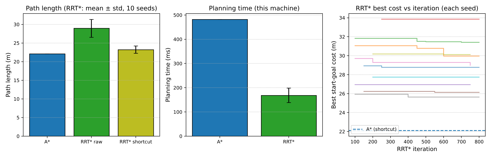
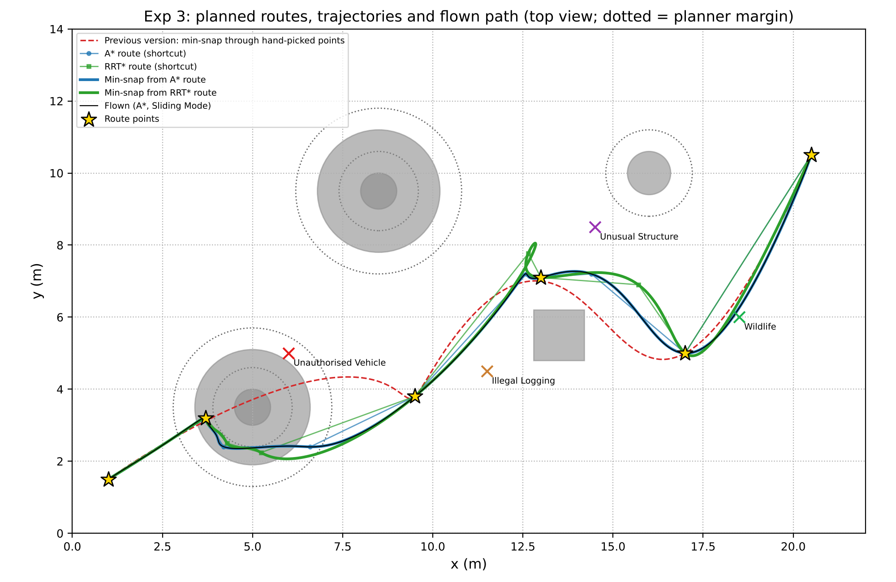
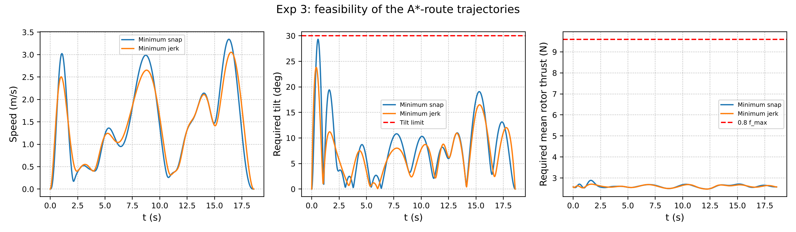
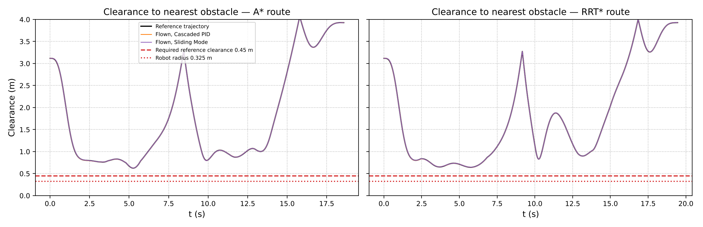
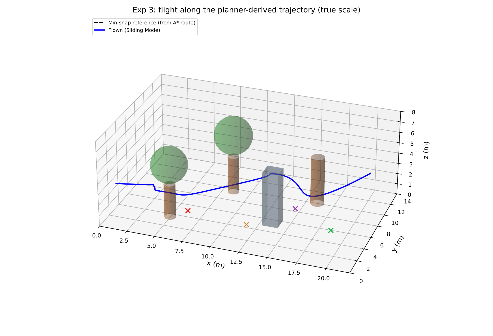

# Path Planning and Trajectory Generation

**Project part 2 — 3D path planning and trajectory generation · Rishika · Group 1**

**Contents:** **Part A** — Practical guide (how to use, run, tune and defend the planning stack). **Part B** — Full reference (derivations, results, tests, limitations).

---

## Part A — Practical Guide

This guide explains *how to use, run, tune and defend* the planning stack. It is the short companion to the full reference in **Part B** below, which contains every derivation, number and limitation. Read this part first; go to Part B for detail.

---

### 1. The big picture

```
 obstacles + bounds          waypoints (survey route)
        │                           │
        ▼                           ▼
 ┌──────────────┐   path    ┌─────────────────┐  trajectory  ┌────────────┐
 │ Environment3D│──────────▶│  plan_route     │─────────────▶│ build_safe_│──▶ reference p(t), v, a, j,
 │  (SDF, margin)│          │ A* or RRT*      │  (waypoints) │ trajectory │    yaw, yaw rate
 └──────────────┘           └─────────────────┘              └────────────┘
                                                              │  min-snap / min-jerk
                                                              │  + clearance refinement
                                                              │  + feasibility check
                                                              ▼
                                                    controllers (PID / SMC)
```

Three stages, one module each:

| Stage | Question it answers | File |
|---|---|---|
| Path planning | Which collision-free waypoints get me from A to B? | `src/path_planning.py` |
| Trajectory generation | How do I move smoothly through them in time? | `src/trajectory.py` |
| Pipeline / checks | Does the *smooth curve* still avoid obstacles and can the drone fly it? | `src/planning_pipeline.py` |

The key lesson of the project: **a collision-free polyline is not a collision-free trajectory.** A smooth curve cuts and overshoots corners, so the pipeline re-checks the curve and adds waypoints until it is safe.

---

### 2. Run it

From the repository root:

```bash
python -m pytest -q tests/test_planning_trajectory.py     # 37 planning/trajectory tests
python experiments/run_experiment3_obstacle_avoidance.py   # plan -> trajectory -> flight -> vision
python -m pytest -q tests                                  # everything (128 tests)
```

The experiment writes `results/metrics/exp3_obstacle_avoidance.{json,md}` and `results/figures/exp3_*.png`. Planning times depend on your machine; every other number is deterministic (fixed seeds).

---

### 3. Minimal usage example

```python
import sys; sys.path.insert(0, "src")
import numpy as np
from path_planning import Obstacle3D, Environment3D, AStarPlanner3D, RRTStarPlanner3D
from planning_pipeline import plan_route, build_safe_trajectory
from trajectory import MinimumSnapTrajectory
from dynamics import QuadcopterParams

# 1. world: bounds + obstacles; one planner margin used everywhere
env = Environment3D(bounds=((0, 22), (0, 14), (0, 8)), safety_margin=0.6)
env.obstacles = [
    Obstacle3D("sphere",   center=[5, 3.5, 5],   radius=1.6),
    Obstacle3D("cylinder", center=[5, 3.5, 0],   radius=0.5, height=3.2),   # centre z = BASE
    Obstacle3D("box",      center=[13.5, 5.5, 2.5], size=[1.4, 1.4, 5.0]),  # size = edge lengths
]

# 2. plan a route through several points (every leg must succeed)
route = np.array([[1, 1.5, 3.5], [9.5, 3.8, 3.5], [20.5, 10.5, 3.5]])
path, info = plan_route(AStarPlanner3D(env, resolution=0.6), route)

# 3. waypoints -> trajectory (clearance refinement + feasibility, time-scaled if needed)
traj, report = build_safe_trajectory(path, env, required_clearance=0.45,
                                     params=QuadcopterParams(), traj_cls=MinimumSnapTrajectory)
print(report["ok"], report["clearance"]["min_clearance_m"], report["time_scale"])
state = traj.evaluate(2.0)   # TrajectoryState: pos, vel, acc, jerk, yaw, yaw_rate
```

Swap in `RRTStarPlanner3D(env, max_iter=800, seed=0, shortcut=True)` to use RRT\*, or `MinimumJerkTrajectory` for `traj_cls`.

**Always check the result.** A path is only valid when `info["success"]` is `True`. On failure the path is an *empty* `(0, 3)` array, never a made-up straight line:

| `info["status"]` | Meaning |
|---|---|
| `success` | full path; every segment passed the collision check |
| `invalid_start` / `invalid_goal` | point is out of bounds or inside the margin |
| `no_path` | A\*: search exhausted (or `max_expansions` reached) |
| `partial` | RRT\*: tree never reached the goal; best branch in `info["partial_path"]` |

`plan_route` fails if *any* leg fails. `report["ok"]` from `build_safe_trajectory` is `True` only if both the clearance requirement and the feasibility check pass.

---

### 4. Concepts in plain language

**Signed-distance function (SDF) and clearance.** For every obstacle there is an exact formula giving the distance from a point to its surface (negative inside). Clearance is the minimum over obstacles. Inflating obstacles by a margin *m* is the same as demanding `clearance > m`. This one idea powers every collision check.

**Segment checking by bisection.** Clearance changes at most as fast as you move (it is 1-Lipschitz). If the midpoint of a sub-segment has clearance greater than `m + L/2`, the whole sub-segment is safe; if it is `≤ m`, the segment is unsafe; otherwise split in half and repeat. This is a *guarantee*, unlike sampling every few tens of centimetres, which can miss thin obstacles.

**A\*.** Searches a 3D lattice (26 neighbours) with cost = Euclidean length and the straight-line-distance heuristic. It is optimal *on the lattice* only, not in continuous space, which is why RRT\* occasionally beats it after shortcutting.

**RRT\*.** Grows a random tree, picks the cheapest parent among nearby nodes, then *rewires* neighbours through the new node when that is cheaper. Rewiring updates the cost of the whole subtree, so stored costs are always exact. It is only asymptotically optimal; with 800 iterations it is a good feasible planner, not an optimal one.

**Shortcutting.** Greedy line-of-sight smoothing: from each waypoint, jump to the furthest waypoint you can see. It never lengthens a path.

**Minimum snap / minimum jerk.** For fixed segment times, find the smooth curve through the waypoints that minimises the integral of squared snap (4th derivative) or jerk (3rd). The optimum is a polynomial per segment (degree 7 / 5), with continuity up to the 6th / 4th derivative at interior waypoints and rest at both ends. Min-snap is natural for quadrotors because thrust and attitude rates depend on the derivatives of position up to snap (differential flatness).

**Time allocation.** Segment time = `max(distance / 2 m/s, 1 s)`. A heuristic, not an optimisation. If the tilt, acceleration or thrust limit is exceeded, *all* times are scaled uniformly by 1.1 until feasible. Uniform scaling keeps the geometry identical, so clearance does not change.

**Yaw.** Follows the direction of travel when moving, and blends smoothly (quintic smoothstep) near stops and sharp corners, with rate limited to 1.5 rad/s. No jumps.

---

### 5. Knobs you can turn

| Parameter | Where | Default / experiment | Effect |
|---|---|---|---|
| `safety_margin` | `Environment3D`, planners | 0.6 m | Obstacle inflation used by planning. Bigger = safer, longer paths, may disconnect narrow gaps. |
| `required_clearance` | `build_safe_trajectory` | 0.45 m | What the *smooth curve* must achieve (robot radius 0.325 m + 0.125 m tracking allowance). Keep it below the planner margin. |
| `resolution` | `AStarPlanner3D` | 0.6 m | Lattice cell size. Smaller = better paths, cost grows roughly with 1/resolution³. |
| `max_iter`, `step_size`, `goal_bias`, `seed` | `RRTStarPlanner3D` | 800, 1.2 m, 0.15, per run | More iterations = better paths. Same seed = same result. |
| `shortcut` | `AStarPlanner3D.plan(..., shortcut=True)`; `RRTStarPlanner3D(..., shortcut=False)` | A\*: on, RRT\*: off | Removes unnecessary waypoints. |
| `average_speed`, `min_segment_time` | trajectory classes | 2 m/s, 1 s | Sets segment durations. |
| `max_yaw_rate` | trajectory classes | 1.5 rad/s | Yaw blend limit. |
| `limits` | `build_safe_trajectory` | tilt ≤ 30°, horizontal accel ≤ 6 m/s², rotor thrust within 0.298 N … 0.8·f_max | Feasibility bounds. |

---

### 6. Troubleshooting

| Symptom | Likely cause | Fix |
|---|---|---|
| `invalid_start` / `invalid_goal` | Point inside an obstacle or closer than the margin | Move it; `nearest_valid_point(env, p, clearance)` does this. |
| `no_path` from A\* | Gap narrower than the inflated obstacles or lattice | Lower `safety_margin` or `resolution`. |
| `partial` from RRT\* | Too few iterations, or no connection | Raise `max_iter`; check `distance_to_goal_m`. |
| `report["ok"]` is False, clearance | Curve still too close after 12 refinements | Lower `required_clearance`, add waypoints by hand, or slow down. |
| `report["ok"]` is False, feasible | Needs more than ×4 time scaling | Reduce route sharpness or raise the allowed scale. |
| `ValueError` from `shortcut_path` | You passed it a path that is not collision-free | Shortcut only valid planner output. |
| Tests fail on a different machine | Only timings should vary | Re-run; every other number is seeded. |

---

### 7. What the results show (A\* route, Sliding Mode, from Exp. 3)

- Planner waypoints were collision-free, but the min-snap curve through them came within **0.359 m** (A\*) and **0.249 m** (RRT\*) of an obstacle. Refinement inserted 3 waypoints, lifting both above **0.6 m**.
- The raw trajectory needed 34.6° tilt (limit 30°); one ×1.1 time scale brought it to 29.3°.
- Closed-loop flight: tracking RMSE ≈ 4 mm, flown clearance ≈ 0.63–0.65 m (robot radius 0.325 m).
- Min-snap has the lower **peak jerk** (14.0 vs 21.8 m/s³); min-jerk has the lower peak speed, acceleration and tilt. Neither wins on every measure.
- The earlier version of the experiment planned paths, then flew a different, hand-picked trajectory that penetrated a tree canopy by 8.5 cm. That is now fixed and covered by tests.

---

### 8. Some questions

1. **Why is a polyline that avoids obstacles not enough?** The smooth curve overshoots corners; we re-check the curve and insert waypoints.
2. **Is A\* optimal?** Only on the lattice and its 26 directions, not in continuous space.
3. **Is RRT\* optimal?** Only as the number of samples tends to infinity. At 800 iterations the radius is stuck at the 1.2 m cap, so we claim feasibility, not optimality.
4. **Why does rewiring update the whole subtree?** Otherwise descendants keep stale costs and later parent choices and goal comparisons are wrong.
5. **Why is the heuristic admissible and consistent?** Straight-line distance never overestimates, and satisfies the triangle inequality across every edge.
6. **Why degree 7 and which continuity for min-snap?** Euler–Lagrange gives `p⁽⁸⁾ = 0`, so degree 7; free knots give C⁶ at interior waypoints.
7. **Why normalise time per segment?** It improves conditioning about 100× (6.5×10³ vs 6.6×10⁵ in our route).
8. **How do you know the closed-form solution is the true minimiser?** A test solves the constrained quadratic program independently and the coefficients and cost match.
9. **What does the feasibility check not prove?** It is a point-mass, drag-only necessary check; it does not model rotor torque, motor lag or disturbances.
10. **Does min-snap beat min-jerk?** Not on every measure: lower peak jerk, but higher peak speed, acceleration and tilt (Part A, Sec. 7).

---

### 9. Known limitations 

Point-sphere robot model; clearance is sampled (with a proven lower bound), not certified in continuous time; refinement is heuristic; time allocation is not optimised; static known obstacles with no replanning; moved survey viewpoints are not checked for camera view. Full list: Part B, Sec. 11.

---

## Part B — Full Reference

This document describes the path planners (`src/path_planning.py`), the trajectory generators (`src/trajectory.py`), the planner-to-trajectory pipeline (`src/planning_pipeline.py`) and the system-level obstacle-avoidance experiment (`experiments/run_experiment3_obstacle_avoidance.py`).

Every result quoted below comes from `results/metrics/exp3_obstacle_avoidance.json` (written by that experiment) or from the tests in `tests/test_planning_trajectory.py`, except a few values from one-off checks run while making these changes; those are marked *(one-off check)*. Planning times depend on the machine; every other number is deterministic, because RRT*, the controllers' sensor noise and the camera's pixel noise all use fixed seeds.

---

### 1. Status at a glance

| Item | Status |
|---|---|
| A* failure handling | Returns `status = "no_path"` and an empty path. It no longer falls back to a direct start–goal line. |
| RRT* failure handling | Returns `status = "partial"` and an empty path. The collision-free branch towards the goal is reported separately in `info["partial_path"]`. |
| RRT* rewiring | Rewiring a node shifts the cost of its whole subtree, so stored costs are always exact path costs. Goal candidates are compared using their final costs. |
| RRT* neighbourhood | Uses the standard rule $r_n=\min(\gamma(\ln n/n)^{1/3},\eta)$. The optimality claim is qualified in §4.4. |
| Planner → trajectory | **Integrated.** The flown trajectory is built from the planner's waypoints (§8). The previous version planned paths but then flew a trajectory through hand-picked waypoints. |
| Continuous clearance | The trajectory is sampled, and waypoints are inserted until the reference clearance is ≥ 0.45 m (§7.1). |
| Polynomial validation | Checks input shape and finiteness, removes repeated waypoints, uses normalised time, checks the condition number and solve residual, and defines behaviour at segment joints and outside the time range. |
| Feasibility | Reports peak speed, acceleration, jerk and snap, plus the required thrust, tilt and thrust-direction rate. Uses uniform time scaling when a limit is exceeded (§7.2). |
| Yaw | Continuous, with its rate limited to ≤ 1.5 rad/s. There is no reset to 0 at stops (§6). |

---

### 2. Workspace, clearance and safety margins

**Obstacles** (`Obstacle3D`) come in three types: spheres, vertical cylinders and axis-aligned boxes. For a cylinder, `center[2]` is the *base*, and the cylinder occupies $z\in[c_z, c_z+h]$. Each obstacle has an exact signed-distance function (SDF), which is negative inside the obstacle:

- sphere: $d(p)=\lVert p-c\rVert-r$
- cylinder: with $d_r=\lVert p_{xy}-c_{xy}\rVert-r$ and $d_z=|p_z-(c_z+h/2)|-h/2$,
  $d(p)=\lVert(\max(d_r,0),\max(d_z,0))\rVert+\min(\max(d_r,d_z),0)$
- box with half-sizes $s$: with $q=|p-c|-s$, $d(p)=\lVert\max(q,0)\rVert+\min(\max_i q_i,0)$

The **clearance** of a point is $\mathrm{clr}(p)=\min_j d_j(p)$, the Euclidean distance to the nearest obstacle surface. Inflating obstacles by a margin $m$ is the same as requiring $\mathrm{clr}(p)>m$. Corners are inflated as the exact Minkowski sum with a ball, so they come out rounded. A point is **valid** if it lies inside the workspace bounds and $\mathrm{clr}(p)>m$.

**Margins used in the experiment** (constants at the top of the experiment file):

| Quantity | Value | Meaning |
|---|---:|---|
| Robot radius | 0.325 m | `arm_length + prop_radius` (0.225 + 0.10); the quadcopter is approximated by an enclosing sphere |
| Required reference clearance | 0.45 m | robot radius + 0.125 m allowance for tracking error |
| Planner margin $m$ | 0.60 m | obstacle inflation used by both planners; leaves 0.15 m for the smooth curve to cut corners of the planned polyline |
| Viewpoint margin | 0.80 m | survey viewpoints that are closer than this to an obstacle are moved (§8) |

Previously the code used three different margins: 0.4 m for A* nodes, 0.3 m for shortcutting and 0.35 m for RRT*. Now one margin per planner is used everywhere, including shortcutting.

---

### 3. Collision checking

**Points.** Exact SDF evaluation, vectorised over many points.

**Segments** (`Environment3D.is_segment_valid`). The clearance function is 1-Lipschitz, so this uses bisection. For a sub-segment with midpoint $q$ and length $L$:

- if $\mathrm{clr}(q)\le m$, the segment is **invalid**;
- if $\mathrm{clr}(q)>m+L/2$, every point of the sub-segment is within $L/2$ of $q$, so the sub-segment is **valid**;
- otherwise the sub-segment is split in two.

Sub-segments shorter than 1 mm are accepted when $\mathrm{clr}(q)>m$. An accepted segment is therefore guaranteed to have clearance $>m-0.5$ mm everywhere. The test `test_segment_check_guarantee_on_random_segments` checks this on 300 random segments. The old checker sampled at 0.2–0.25 m spacing and could miss thin obstacles; `test_segment_check_catches_thin_crossing_and_accepts_near_miss` covers a 5 cm sphere.

**A\* edges.** If both lattice end-points satisfy $\min(\mathrm{clr}(u),\mathrm{clr}(v))>m+|u-v|/2$, the edge is valid without further checks (same Lipschitz argument). Otherwise the full segment check runs. Previously only the nodes were checked, so a diagonal edge could clip an obstacle corner.

**Trajectories** (`trajectory_clearance`). The trajectory is sampled every $\Delta t=0.01$ s. Consecutive samples are at most $v_{\max}\Delta t$ apart, so the true minimum clearance is at least the sampled minimum minus $v_{\max}\Delta t/2$. This lower bound is reported as `min_clearance_lower_bound_m`, and `test_clearance_lower_bound_is_valid` checks it.

---

### 4. Path planners

Both planners return `(path, info)`. A path counts as a result only when `info["success"]` is `True`. On failure the path is an empty `(0, 3)` array and `info["status"]` is one of:

| Status | Meaning |
|---|---|
| `success` | complete start → goal path; every segment has passed the segment check |
| `invalid_start` / `invalid_goal` | the point is out of bounds or within the margin |
| `no_path` | A*: the search space was exhausted, or `max_expansions` was reached |
| `partial` | RRT*: the tree never connected to the goal; the branch to the node nearest the goal is in `info["partial_path"]` and its distance in `info["distance_to_goal_m"]` |

#### 4.1 A* (`AStarPlanner3D`)

- **Graph.** Lattice points $x_{\min}+\Delta(i,j,k)$, where $\Delta$ is the `resolution` (0.6 m in the experiment), with 26-connectivity. A node is used only if its clearance is $>m$, and an edge only if it is valid (§3).
- **Start and goal.** These generally do not lie on the lattice. Each is connected to the valid lattice nodes in its surrounding $3\times3\times3$ block by a checked segment. If none of these connections is valid, the result is `no_path`.
- **Costs.** Edge cost is the Euclidean length ($\Delta$, $\sqrt2\Delta$ or $\sqrt3\Delta$). The heuristic is $h(n)=\lVert n-g\rVert$, which never exceeds the true remaining cost, so it is admissible. It also satisfies the triangle inequality across every edge, so it is consistent.
- **Termination.** For a node $n$ that connects to the goal, the complete cost is $g(n)+\lVert n-g\rVert=f(n)$. The search stops as soon as the smallest open $f$ is at least the best complete cost found so far. This makes the result optimal **on this graph**, but not in continuous space: it is limited by the lattice and by the 26 edge directions.
- **Direct check.** If the straight start–goal segment is valid, it is returned without searching (`try_direct=True`). This is a checked result, not a fallback.
- **Shortcutting** (§4.3) is applied to the lattice path. Both the raw and the shortcut lengths are reported.

#### 4.2 RRT* (`RRTStarPlanner3D`)

This follows Karaman & Frazzoli (2011). Each iteration:

1. **Sample.** With probability `goal_bias` (0.15) the sample is the goal; otherwise it is uniform in the bounds. Sampling uses `numpy.random.default_rng(seed)`, so a seed makes the run reproducible.
2. **Nearest and steer.** Move from the nearest node at most $\eta$ = `step_size` (1.2 m) towards the sample. The new segment must be valid.
3. **Near set.** All nodes within $r_n=\min\big(\gamma(\ln n/n)^{1/3},\ r_{\text{cap}}\big)$, plus the nearest node. Here $r_{\text{cap}}=\eta$ by default.
4. **Choose parent.** Candidates are tried in increasing order of $c(x)+\lVert x-x_{\text{new}}\rVert$, and the first one with a valid segment is chosen.
5. **Rewire.** For each near node $x$: if $c(x_{\text{new}})+\lVert x_{\text{new}}-x\rVert<c(x)$ and the segment is valid, re-parent $x$ to $x_{\text{new}}$ and add $\delta=c_{\text{new}}(x)-c(x)<0$ to the cost of **every node in the subtree of $x$** (breadth-first over a child list).
6. **Goal candidate.** If $\lVert x_{\text{new}}-g\rVert\le\eta$ and that segment is valid, $x_{\text{new}}$ is recorded as a goal candidate. After the loop, the candidate with the smallest *current* $c(x)+\lVert x-g\rVert$ is used.

**Why step 5 matters.** The old code updated only the rewired node's own cost. Its descendants kept stale costs, which then misled later parent choices and goal comparisons. Goal nodes were also stored as tree nodes with costs fixed when they were created. Now `test_rrt_star_costs_stay_exact_after_rewiring` checks $c(i)=c(\text{parent}(i))+\lVert x_i-x_{\text{parent}(i)}\rVert$ for every node, and `test_rrt_star_rewire_updates_descendants` checks a run in which rewired nodes had children (`subtree_rewires > 0`). With the subtree update disabled, both tests fail *(one-off check: update temporarily removed)*.

#### 4.3 Shortcutting (`shortcut_path`)

Greedy line of sight: from waypoint $i$, jump to the furthest later waypoint $j$ whose segment $i\to j$ is valid, using the planner's margin. The shortcut path cannot be longer than the input (triangle inequality), and every kept segment has been checked. The fallback $j=i+1$ is valid only because the input path is valid, so an invalid input raises `ValueError` instead of being passed through.

#### 4.4 What "asymptotically optimal" does and does not mean here

RRT* is asymptotically optimal if $\gamma>\gamma^*=2(1+1/d)^{1/d}\big(\mu(X_{\text{free}})/\zeta_d\big)^{1/d}$, where $d=3$ and $\zeta_3=4\pi/3$ is the volume of the unit ball. The code computes $\gamma^*$ from the volume of the bounding box. This is an upper bound on $\mu(X_{\text{free}})$, so the condition still holds. With $\gamma=1.1\gamma^*$:

- Experiment workspace (22 × 14 × 8 m): $\gamma^*=18.44$ and $\gamma=20.29$.
- $\gamma(\ln n/n)^{1/3}$ stays above the cap $\eta=1.2$ m until about **$n\approx 5.5\times10^4$** nodes. In the experiment (800 iterations, ≈630 nodes) the near radius is therefore **constant at 1.2 m** (the JSON reports `near_radius_first_last = [1.2, 1.2]`).

So the implementation follows the standard rule, but at this iteration budget it behaves like RRT* with a fixed 1.2 m radius. Asymptotic optimality is a statement about the limit $n\to\infty$. A run of 800 iterations returns a feasible path, improved by rewiring, with **no optimality guarantee**. Section 9.2 shows that the best cost barely improves after the first solution is found.

---

### 5. Polynomial trajectory generation

#### 5.1 Problem and solution

Given waypoints $w_0,\dots,w_M$ and segment durations $T_0,\dots,T_{M-1}$, find a piecewise polynomial $p(t)$ for each axis that minimises

$$J_n=\sum_{k}\int_0^{T_k}\big\lVert p_k^{(n)}(t)\big\rVert^2\,dt,$$

subject to $p_k(0)=w_k$, $p_k(T_k)=w_{k+1}$ and rest at both ends: $p^{(r)}=0$ for $r=1,\dots,n-1$ at $t=0$ and at $t=T$. The interior derivatives are left free.

On each segment the Euler–Lagrange equation gives $p^{(2n)}=0$, so each piece is a polynomial of **degree $2n-1$**. Leaving the knots free gives natural conditions that make the optimum **$C^{2n-2}$** continuous at interior waypoints. The code solves exactly this square system:

| Equations | Count |
|---|---:|
| position at both ends of each segment | $2M$ |
| rest at start, $r=1..n-1$ | $n-1$ |
| rest at end, $r=1..n-1$ | $n-1$ |
| continuity of $p^{(r)}$, $r=1..2n-2$, at $M-1$ joints | $(2n-2)(M-1)$ |
| **total = unknowns** | $2nM$ |

| | Minimum snap ($n=4$) | Minimum jerk ($n=3$) |
|---|---|---|
| Degree | 7 | 5 |
| Continuity at interior waypoints | $C^6$ | $C^4$ |
| End conditions | $v=a=j=0$ | $v=a=0$ (end jerk generally ≠ 0) |

This corrects the previous descriptions, which said $C^3$ for minimum snap and $C^2$ for minimum jerk. The code already imposed $C^6$ and $C^4$; only the text was wrong. The earlier claim that minimum snap "directly minimises rotor acceleration" has been removed, because the code does not show it.

**Check against an optimiser.** `test_solution_equals_constrained_qp_minimum` solves the equality-constrained quadratic program directly (KKT system). It requires only $C^{n-1}$ continuity, the weakest continuity with finite cost, and leaves everything else free. Its coefficients and cost match the closed-form solution for both generators. The solution is therefore the true minimiser **for the given durations**. The durations themselves are not optimised (§5.4).

Because the minimum-snap curve satisfies every minimum-jerk constraint, $J_3(\text{min-jerk})\le J_3(\text{min-snap})$ (tested). The reverse comparison of snap costs is not meaningful: the minimum-jerk curve has non-zero jerk at its end points, so it is not an admissible minimum-snap candidate.

#### 5.2 Numerics

- **Normalised time.** Each segment uses $\tau=t/T_k\in[0,1]$ with $p_k(\tau)=\sum_i c_{k,i}\tau^i$, so $d^rp/dt^r=T_k^{-r}\,d^rp/d\tau^r$. Continuity rows are multiplied by $T_k^r$, giving $p_k^{(r)}(1)-(T_k/T_{k+1})^r p_{k+1}^{(r)}(0)=0$, and every row is scaled to unit max-norm. All three axes share one matrix.
- **Effect.** For the final A*-route waypoints of the experiment, the condition number is 6.5 × 10³ (minimum snap) and 4.2 × 10² (minimum jerk). The previous raw-time formulation on the same waypoints gave 6.6 × 10⁵ and 1.1 × 10⁴ *(one-off check)*, so normalising improves conditioning by about 100×. A system with condition number above 10⁸ raises a warning, and above 10¹² the solve is refused. The solve residual is stored. The new formulation reproduces the old position, velocity, acceleration and jerk to within 6 × 10⁻¹⁴ (SI units), so Experiments 1–8, which use minimum snap through `missions.py`, are unchanged *(one-off check: all 4 391 numbers in `metrics_summary.json` identical before and after)*.
- **Input validation.** Waypoints must have shape (M, 3) and be finite, with at least 2 distinct points. `average_speed`, `min_segment_time` and `time_scale` must be positive. Explicit `durations` must be M−1 positive values. **Consecutive repeated waypoints** are removed (tolerance 1 µm) and listed in `removed_waypoints`. Keeping them would force the curve to leave the point and return to it within at least 1 s. If all waypoints coincide, a `ValueError` is raised.

#### 5.3 Evaluation and boundaries

- `derivative(t, r)` returns the $r$-th time derivative for a scalar or an array of times. `evaluate(t)` returns position, velocity, acceleration, jerk, yaw and yaw rate.
- At a joint, $t=t_k$ is assigned to segment $k$ at $\tau=0$. Because of continuity, every derivative up to order $2n-2$ is the same from either side; `test_continuity_waypoints_and_rest_conditions` checks derivatives up to order $2n-2$.
- **Outside $[0,T]$** the reference holds the end point with zero velocity, acceleration and jerk. Before this change the last segment's polynomial derivatives were simply clamped.
- The minimum-jerk end jerk is not zero, so its jerk steps to zero at $t=T$. This is a property of the minimum-jerk formulation.

#### 5.4 Time allocation

$$T_k=\alpha\cdot\max\!\left(\frac{\lVert w_{k+1}-w_k\rVert}{v_{\text{avg}}},\ T_{\min}\right),\qquad v_{\text{avg}}=2\ \text{m/s},\ T_{\min}=1\ \text{s},$$

where $\alpha$ is the uniform `time_scale` (default 1); explicit durations can be passed instead. This is a heuristic, not an optimisation. Its effect is visible in Fig. 3: short segments, including waypoints inserted by the clearance refinement, are stretched to 1 s, while long segments run near or above $v_{\text{avg}}$. Speed is therefore uneven: the A*-route trajectory peaks at 3.34 m/s and slows to about 0.2 m/s around the first viewpoint.

**Uniform time scaling** is exact. Scaling every duration by $\alpha$ gives the same geometric curve, $p_\alpha(t)=p(t/\alpha)$, with $v\to v/\alpha$, $a\to a/\alpha^2$ and $j\to j/\alpha^3$; this is tested in `test_rest_outside_time_range_and_time_scaling`. The pipeline uses this to fix infeasibility without changing clearance (§7.2).

---

### 6. Yaw reference

Wherever the horizontal speed is above 0.1 m/s **and** that heading turns no faster than `max_yaw_rate` (1.5 rad/s), the yaw follows the velocity direction:

$$\psi=\operatorname{atan2}(v_y,v_x),\qquad \dot\psi=\frac{v_xa_y-v_ya_x}{v_x^2+v_y^2}.$$

Everywhere else (take-off, stops, landing, sharp corners) the yaw blends with a quintic smoothstep $s(\tau)=10\tau^3-15\tau^4+6\tau^5$ from the heading before the interval to the heading after it, the shorter way round. It starts from `initial_yaw` (0) and holds through the final stop. The blend's peak rate is $1.875|\Delta\psi|/D$; the window duration $D$ is widened (and overlapping windows merged) until this is ≤ `max_yaw_rate`. Yaw is unwrapped, so it is continuous; the controller wraps the yaw *error*.

**Previous behaviour:** below 0.1 m/s the yaw was set to 0. On the old experiment trajectory this produced a 68° jump within 10 ms at the final stop *(one-off check)*. **Now** `test_yaw_is_continuous_and_rate_limited` checks a near-reversal corner: no step larger than the rate limit allows, $|\dot\psi|\le$ limit, the held final heading, and that the reported rate matches the numerical derivative. Limitation: the yaw *rate* can step at the edges of a blend window. It is bounded but not continuous.

---

### 7. Checking a trajectory

#### 7.1 Clearance refinement (`build_safe_trajectory`)

The planned polyline has clearance > 0.6 m, but the smooth curve through its vertices can cut or overshoot corners. The procedure is:

1. Fit the trajectory and sample its clearance (§3).
2. If the minimum is below 0.45 m, split every segment whose samples violate the requirement, **and** both segments adjacent to the waypoint nearest in time to each violating sample. Each split inserts the segment midpoint. Midpoints lie on the planned polyline, so they are themselves valid.
3. Repeat, up to 12 times, and never split segments shorter than 5 cm.

Splitting only the violating segment is not enough. In the experiment the violation is an *overshoot past a vertex*, so the segment that gets split is the wrong one: an earlier version of this loop inserted 12 points and stalled at 0.429 m *(one-off check)*. Splitting both neighbours of the vertex fixed it in one iteration (§9.3). `test_pipeline_refines_until_trajectory_clearance_is_met` checks the result on an L-shaped corridor at 2 ms sampling.

#### 7.2 Dynamic feasibility (`trajectory_feasibility`)

This uses a point-mass model with the same linear drag $D=\mathrm{diag}(0.15,0.15,0.25)$ as `dynamics.py`:

$$F=m(a+g e_3)+Dv,\qquad \text{tilt}=\arccos\frac{F_z}{\lVert F\rVert},\qquad \dot F=m j+Da,\qquad \omega_\perp=\frac{\lVert(I-zz^\top)\dot F\rVert}{\lVert F\rVert},\ z=\frac{F}{\lVert F\rVert}.$$

Reported values: peak speed, acceleration, jerk and snap; required tilt; thrust-direction rate $\omega_\perp$; minimum and maximum collective thrust; mean rotor thrust $\lVert F\rVert/4$; peak yaw rate; $\int\lVert j\rVert^2dt$ and $\int\lVert s\rVert^2dt$.

A trajectory is feasible if:

- tilt ≤ 30° (`CommonLimits.max_tilt_angle`);
- horizontal acceleration ≤ 6 m/s² (`max_horizontal_accel`);
- $f_{\min}=0.298$ N ≤ mean rotor thrust ≤ $0.8f_{\max}=9.60$ N. The 20 % headroom is kept for differential thrust.

If a limit is exceeded, all durations are multiplied by 1.1 until the trajectory is feasible, up to ×4.

This is a **necessary check on the reference**, not a proof that a controller can track it. It ignores rotor dynamics, per-rotor torque demand and disturbances. Section 9.4 tests tracking separately in closed loop.

---

### 8. The integrated pipeline and experiment

`experiments/run_experiment3_obstacle_avoidance.py`:

- **Environment.** A 22 × 14 × 8 m box containing two trees (a trunk cylinder plus a canopy sphere each), a 1.4 × 1.4 × 5 m watchtower box and a pylon cylinder. Four ground anomalies.
- **Route.** Start (1, 1.5, 3.5), then four anomaly viewpoints, then the base (20.5, 10.5, 3.5). These are the same points as the previous version, except that any viewpoint closer than 0.8 m to an obstacle is moved to the nearest grid point (0.1 m grid) that is clear (`nearest_valid_point`).
- **Planning.** `plan_route` plans every leg with the planner and concatenates the legs. **If any leg fails, the whole route fails** (`test_route_failure_propagates`).
- **Trajectory.** `build_safe_trajectory` uses minimum snap through the planned waypoints, with clearance refinement and the feasibility check. Minimum jerk is generated on the same final waypoints and time scale for comparison.
- **Flight.** Both controllers fly the **planner-derived** minimum-snap trajectory with the seeded sensor noise of Experiments 1–8 (`common.run_both`).
- **Vision.** Anomaly detection at 5 Hz along the A* / Sliding Mode flight.

`test_experiment_flies_planner_derived_trajectory` checks that every planner waypoint is a waypoint of the flown trajectory and that the trajectory's clearance requirement is met.

---

### 9. Results

#### 9.1 Audit of the previous version

| | Value |
|---|---:|
| Clearance of hand-picked viewpoint 1, (4.5, 3.5, 3.5) | **−0.019 m** (inside the tree-1 canopy sphere) |
| Minimum clearance of the minimum-snap trajectory that was flown | **−0.085 m** at t = 2.13 s |
| Time inside an obstacle / closer than the robot radius | 0.25 s / 0.87 s |

The previous experiment planned A* and RRT* paths, discarded them, and flew through the tree-1 canopy (red dashed curve in Fig. 2).

#### 9.2 Planner comparison (direct start → goal query)

| | A* | RRT* raw (10 seeds) | RRT* shortcut |
|---|---:|---:|---:|
| Success | 1/1 | 10/10 | 10/10 |
| Path length (m) | 22.10 (raw lattice 23.11, 33 → 4 points) | 28.96 ± 2.39 (25.63–33.86) | 23.24 ± 0.97 |
| Planning time (ms) | 413 (1 219 expansions) | 153 ± 20 | — |
| Minimum path clearance (m) | 0.657 | ≥ 0.611 | ≥ 0.611 |

Observations:

- **A\* gives the shortest path on average.** Raw RRT* paths are 31 % longer.
- **Shortcutting closes most of the gap** (23.24 ± 0.97 m). Two seeds give 21.97 m after shortcutting, slightly shorter than A*'s 22.10 m. That is possible because A* is optimal only on the lattice.
- **RRT\* improves very little after its first solution.** Between the first 50-iteration checkpoint with a solution and iteration 800, the best cost fell by at most 1.1 m for any seed, and by 0 m for three seeds (Fig. 1, right; values from `cost_history`). This is consistent with §4.4: the near radius is the constant 1.2 m cap and there are only ≈630 nodes, ≈65 rewires per run on average.
- **Times are machine-dependent.** On this machine RRT* was faster than A*; the previous version reported the opposite. RRT* now uses vectorised segment checks and lazy parent checking.



*Fig. 1 — Left: path length. Centre: planning time. Right: best start–goal cost against iteration for each RRT* seed.*

#### 9.3 Route → trajectory

Viewpoint 1 was moved 0.99 m, from (4.5, 3.5, 3.5) to (3.7, 3.2, 3.0), out of the canopy. Viewpoint 3 was moved 0.10 m, because it was clear of obstacles by only 0.80 m and the threshold is strict.

| | A* min-snap | A* min-jerk | RRT* min-snap | RRT* min-jerk |
|---|---:|---:|---:|---:|
| Route length (m) | 26.24 | — | 28.32 | — |
| Clearance before refinement (m) | **0.359** | — | **0.249** | — |
| Inserted waypoints | 3 | — | 3 | — |
| Minimum clearance (m) | 0.625 | 0.610 | 0.644 | 0.654 |
| Time scale | 1.10 | 1.10 | 1.10 | 1.10 |
| Duration (s) | 18.58 | 18.58 | 19.45 | 19.45 |
| Peak speed (m/s) | 3.34 | 3.05 | 3.82 | 3.30 |
| Peak acceleration (m/s²) | 4.89 | 3.93 | 4.89 | 3.93 |
| Peak jerk (m/s³) | 14.0 | 21.8 | 14.0 | 21.8 |
| Maximum required tilt (deg) | 29.3 | 23.8 | 29.3 | 23.8 |
| Maximum mean rotor thrust (N) | 2.89 | 2.71 | 2.89 | 2.86 |
| Peak yaw rate (rad/s) | 1.50 | 1.50 | 1.50 | 1.50 |
| $\int\lVert j\rVert^2dt$ | 248.5 | 161.1 | 294.0 | 199.5 |
| Feasible | yes | yes | yes | yes |

Observations:

- **Planner-clear waypoints are not enough on their own.** The minimum-snap curve through the planned waypoints came within 0.359 m (A*) and 0.249 m (RRT*) of an obstacle. Both are below the 0.45 m requirement, and the RRT* case is below the 0.325 m robot radius. After refinement both exceed 0.6 m.
- **Time scaling was needed.** Before scaling, the A*-route minimum-snap trajectory required 34.6° of tilt *(one-off check)*, above the 30° limit. One ×1.1 time scale brought it to 29.3°.
- **Minimum snap versus minimum jerk on the same waypoints and durations.** Minimum snap has **lower peak jerk** (14.0 vs 21.8 m/s³). Minimum jerk has **lower peak speed, acceleration and tilt**, and a lower integrated squared jerk, as its cost function predicts. Neither is better on every measure.
- **Same peaks on both routes.** Peak acceleration, jerk and tilt are almost identical for the two routes because both occur in the first leg (t ≈ 0.6 s). After refinement that leg is the same for both planners.
- **Overshoot loop on the RRT* route.** Near (12.8, 8.0) the RRT*-route minimum-snap curve makes a small loop (Fig. 2). It is collision-free but is wasted motion. It sits at a sharp turn at the RRT* waypoint (12.65, 7.77, 4.89), which also requires a 1.3 m climb and descent.



*Fig. 2 — Grey: obstacles; dotted circles: planner margin (spheres and cylinders). The top view hides altitude: the A* route passes beside the tree-1 trunk at z = 3.0 m, below the canopy.*



*Fig. 3 — Speed, required tilt and required mean rotor thrust for the A*-route trajectories.*

#### 9.4 Closed-loop flight of the planner-derived trajectories

Seeded sensor noise (σ_pos = 1 cm, σ_vel = 2 cm/s, σ_att = 0.3°, σ_gyro = 0.01 rad/s), dt = 0.01 s.

| Route | Controller | RMSE (m) | Max error (m) | Flown minimum clearance (m) |
|---|---|---:|---:|---:|
| A* | Cascaded PID | 0.0044 | 0.0144 | 0.627 |
| A* | Sliding Mode | 0.0042 | 0.0111 | 0.627 |
| RRT* | Cascaded PID | 0.0041 | 0.0144 | 0.645 |
| RRT* | Sliding Mode | 0.0039 | 0.0112 | 0.646 |

The maximum tracking error (≤ 1.44 cm) is well inside the 12.5 cm tracking allowance. The flown clearance stays about 0.30 m above the robot radius. These flights have no wind or force disturbances; Experiment 2 covers those separately.



*Fig. 4 — Clearance against time for the reference and the flown paths. The flown curves lie on top of the reference.*



#### 9.5 Anomaly detection (A* route, Sliding Mode)

119 detections at 5 Hz; all 4 targets detected. Best geolocation errors: 0.016 m (unauthorised vehicle), 0.012 m (illegal logging), 0.061 m (unusual structure), 0.019 m (wildlife).

`anomaly_detection.py` adds Gaussian pixel noise from NumPy's global random generator, which the previous version never seeded, so its geolocation numbers changed from run to run. The experiment now seeds it (`np.random.seed(0)`). In unseeded runs of the same flight *(one-off check)*, the best errors per target varied between about 0.01 m and 0.06 m, so differences of a few centimetres between targets are noise, not a property of the target.

---

### 10. Tests (`tests/test_planning_trajectory.py`, 37 tests)

| Area | Tests |
|---|---|
| Geometry and collision | SDF values for each obstacle type; thin-obstacle crossing; near-miss acceptance; clearance guarantee on 300 random segments |
| A* | collision-free path (raw and shortcut); wall → `no_path` with empty path; invalid start/goal; expansion limit is a failure |
| RRT* | collision-free and reproducible with a seed; wall → `partial` with empty path and a valid partial branch; invalid goal; exact costs after rewiring; subtree cost update; near-radius rule |
| Shortcutting | stays valid, never longer, rejects invalid input |
| Polynomials | waypoint interpolation; $C^{2n-2}$ continuity; rest end conditions; equality with the QP optimum (both orders); cost comparison; input validation; repeated waypoints; conditioning; behaviour outside $[0,T]$; time-scaling law |
| Yaw | continuity, rate limit and hold at a near-reversal corner (both orders); vertical flight keeps `initial_yaw` |
| Pipeline | refinement reaches the required clearance at 2 ms sampling; planned waypoints are on the trajectory; clearance lower bound; feasibility at hover; infeasible → time scaling; route failure propagates; viewpoint repair; the experiment flies the planner-derived trajectory |

---

### 11. Limitations

1. **Point-robot model.** The quadcopter is treated as a 0.325 m sphere, and orientation is ignored for collision. The 0.125 m tracking allowance is chosen from observed tracking error (≤ 1.44 cm here; larger under the disturbances of Experiment 2) and is not derived formally.
2. **Clearance is sampled.** The reported minimum has a computed lower bound, but there is no continuous-time certificate.
3. **Refinement is heuristic.** Inserting midpoints worked in one iteration here, but convergence is not proven. If the loop gives up, `ok = False` is reported and the trajectory is not silently used.
4. **Time allocation is not optimised** (§5.4). Speeds are uneven, and the 1 s minimum per segment slows short segments.
5. **Feasibility is a necessary check** on a point-mass, drag-only model. It does not model per-rotor torque demand, motor lag or disturbances.
6. **RRT\* within 800 iterations** behaves like fixed-radius RRT* (§4.4). Its results depend on the seed, which is why 10 seeds are reported.
7. **A\* is lattice-optimal only**, and its cost grows with the cube of the workspace size divided by the resolution. The start and goal must reach a valid lattice node within their surrounding $3\times3\times3$ block.
8. **Static, known obstacles; no replanning.** Wind and other disturbances are not part of this experiment.
9. **Survey viewpoints** are repaired geometrically (moved to the nearest clear point). Whether a moved viewpoint still gives the camera the intended view of its anomaly is not checked, although all four targets were detected in this run.
10. **Yaw rate** is bounded but can step at the edges of blend windows.

---

### 12. Implementation map and references

| Concept | Code |
|---|---|
| SDFs, clearance, segment check | `path_planning.py`: `Obstacle3D.signed_distance`, `Environment3D.clearance`, `is_segment_valid` |
| A* | `AStarPlanner3D.plan`, `_search`, `_connectors`, `_edge_valid` |
| RRT* | `RRTStarPlanner3D.plan`, `near_radius`, `rrt_star_gamma_star` |
| Shortcutting | `shortcut_path` |
| Polynomial solver | `trajectory.py`: `PiecewisePolynomialTrajectory._solve`, `derivative`, `cost` |
| Yaw | `_build_yaw_profile`, `_yaw` |
| Clearance, feasibility, refinement | `planning_pipeline.py`: `trajectory_clearance`, `trajectory_feasibility`, `build_safe_trajectory` |
| Route planning, viewpoint repair | `plan_route`, `nearest_valid_point` |
| Experiment | `experiments/run_experiment3_obstacle_avoidance.py` → `results/metrics/exp3_obstacle_avoidance.{json,md}`, `results/figures/exp3_*.png` |

1. P. E. Hart, N. J. Nilsson, B. Raphael, "A formal basis for the heuristic determination of minimum cost paths," *IEEE Trans. Systems Science and Cybernetics*, 1968. (A*, admissible and consistent heuristics.)
2. S. Karaman, E. Frazzoli, "Sampling-based algorithms for optimal motion planning," *Int. J. Robotics Research*, 2011. (RRT*, $\gamma^*$, near radius.)
3. D. Mellinger, V. Kumar, "Minimum snap trajectory generation and control for quadrotors," *ICRA*, 2011. (Minimum-snap trajectories, differential flatness.)
4. C. Richter, A. Bry, N. Roy, "Polynomial trajectory planning for aggressive quadrotor flight in dense indoor environments," *ISRR 2013 / Springer*, 2016. (Planner waypoints → polynomial; inserting waypoints to fix collisions.)
5. T. Flash, N. Hogan, "The coordination of arm movements: an experimentally confirmed mathematical model," *J. Neuroscience*, 1985. (Minimum-jerk trajectories.)
